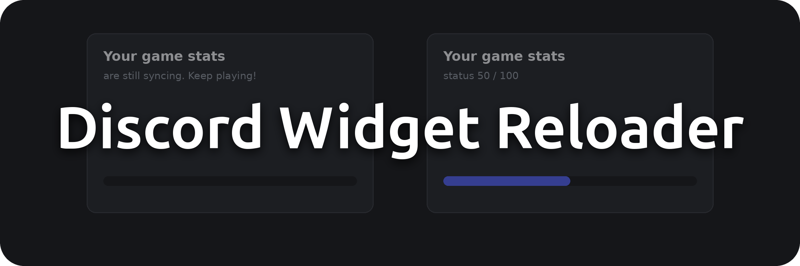

<div align="center">

<p align="center">
  
</p>

<p align="center"><a href="README.md">English</a> | <b>日本語</b></p>

<h1 align="center">Discord Widget Reloader</h1>

<h3 align="center">Discord の Profile Widgets v2 が「同期中」のまま止まる問題を避ける。</h3>

<p align="center">一定間隔で Discord の内部 API にウィジェットのデータを PATCH し続ける常駐コンテナです。プロフィールのウィジェットが <code>Your game stats are still syncing. Keep playing!</code> のまま進まなくなるのを防ぎます。</p>

<p align="center">
  <a href="https://github.com/Lapius7/discordwidget-reloader/commits/main"></a>
  <a href="LICENSE"></a>
  <a href="https://www.docker.com"></a>
  <a href="https://www.python.org"></a>
  <a href="https://github.com/Lapius7/discordwidget-reloader/stargazers"></a>
</p>

<p align="center">
  <a href="#quick-start">Quick start</a> ·
  <a href="#前提条件">前提条件</a> ·
  <a href="#設定項目">設定項目</a> ·
  <a href="#トラブルシューティング">トラブルシューティング</a>
</p>

</div>

---

> [!WARNING]
> Profile Widgets v2 は **Discord が正式公開していない実験的機能**です。予告なく仕様変更・廃止される可能性があります。
> Bot Token を使った内部 API への直接アクセスは、Discord の利用規約上グレーゾーンです。**自己責任で利用してください。** 大量アカウントでの利用や、過度に短い同期間隔での連打など、Discord のインフラに負荷をかける使い方はしないでください。
> 本リポジトリの作者は、利用によって生じたアカウント停止などのいかなる不利益についても責任を負いません。

## 概要

Discord の実験的機能「Profile Widgets v2」でプロフィールに表示したウィジェットが、`Your game stats are still syncing. Keep playing!`（同期中）のまま進まなくなることがあります。このコンテナは `widget_data.json` の内容を `SYNC_INTERVAL_SECONDS` 秒（既定 300）ごとに Discord API へ送り、その状態を避けます。

参考: [Discord Widgets, chloecinders.com](https://chloecinders.com/blog/discord-widgets)

`app/sync.py` は `https://discord.com/api/v9/applications/{APPLICATION_ID}/users/{USER_ID}/identities/0/profile` に、`Authorization: Bot <token>` を付けて `PATCH` を送り、成否を毎回ログに出します。

## 前提条件

このコンテナの範囲外です。事前に Discord 上で完了させておいてください。

1. [Discord Developer Portal](https://discord.com/developers/applications) でアプリケーションを作成し、`Games` → `Social SDK` を有効化する
2. アプリケーションをチーム所有にする（個人所有のままだと `Games` タブの条件を満たせない場合がある）
3. ブラウザの開発者コンソールで実験フラグを有効化し、`Widget` タブを表示させて、Widget を作成・Publish する
   - フラグ名は変更される可能性があるため、最新情報は上記ブログ記事や関連コミュニティを参照してください
4. OAuth2 で `openid` + `sdk.social_layer` スコープを許可し、ユーザートークンでの認可を済ませる
5. Discord クライアントのコンソールで、対象アプリケーション ID を featured アプリケーション一覧に追加する
6. ユーザー設定 → プロフィール編集 → Profile Widgets から、作成したウィジェットをプロフィールに追加する

> [!IMPORTANT]
> 上記が完了していないと、このコンテナが PATCH を送ってもプロフィール上の表示は変わりません。

## Quick start

```bash
# 1. リポジトリを取得
git clone https://github.com/Lapius7/discordwidget-reloader
cd discordwidget-reloader

# 2. 環境変数ファイルを作成
cp .env.example .env
nano .env
# DISCORD_APPLICATION_ID, DISCORD_USER_ID, DISCORD_BOT_TOKEN を設定

# 3. 送信するウィジェットデータを作成
cp widget_data.sample.json widget_data.json
nano widget_data.json
# Developer Portal の Games → Widget → Sample Data タブの
# 「Generate JSON」で生成した JSON を参考に、自分のウィジェット構成に合わせて書き換える

# 4. 起動
docker compose up -d --build

# 5. ログ確認（一定間隔で PATCH の成否が出力される）
docker compose logs -f

# 6. 停止
docker compose down
```

ディレクトリ構成:

```
discordwidget-reloader/
├── docker-compose.yml
├── Dockerfile
├── .env.example              ← コピーして .env を作成
├── widget_data.sample.json   ← コピーして widget_data.json を作成
└── app/
    └── sync.py               ← 定期 PATCH 送信スクリプト
```

## 設定項目

| 環境変数 | 説明 |
|---|---|
| `DISCORD_APPLICATION_ID` | Developer Portal の General Information に表示される Application ID |
| `DISCORD_USER_ID` | ウィジェットを表示する自分の Discord ユーザー ID |
| `DISCORD_BOT_TOKEN` | Bot ページで Reset Token して取得したトークン |
| `SYNC_INTERVAL_SECONDS` | PATCH 送信間隔（秒）。既定は 300 |

## VPS など常時稼働環境で動かす場合

同期が続くのは、このコンテナが動いている間だけです。コンテナを止めると、最後に送った内容はそのまま表示され続けますが、一定時間（数分〜数十分程度）がたつと再び「同期中」表示に戻ります。

自宅 PC など電源を落とす環境では、PC がオフの間は同期が途切れます。常時起動している VPS や NAS などで動かすことをおすすめします。

## トラブルシューティング

- **`403 {"message": "internal network error", "code": 40333}` が出る場合**
  `Authorization: Bot <token>` のリクエストに、ブラウザを偽装した `User-Agent` ヘッダーを付けていると、Cloudflare 側で不審なリクエストとして弾かれることがあります。`sync.py` では `User-Agent` を明示的に設定していません（Python の既定のまま送信）。独自にヘッダーを追加する場合は注意してください。
- **PATCH は成功しているのにプロフィール表示が変わらない場合**
  Discord クライアント側のキャッシュが残っていることがあります。`Ctrl+Shift+R`（ブラウザ）や、Discord アプリの再読み込み（`Ctrl+R`）を試してください。Widget 構成を編集・Publish した直後も同様です。

> [!NOTE]
> 未検証: この README の作り直しでは、実際の Discord API に対するコンテナの動作と、実験的機能そのものの挙動は確かめていません。

## ライセンス

[MIT](LICENSE)
