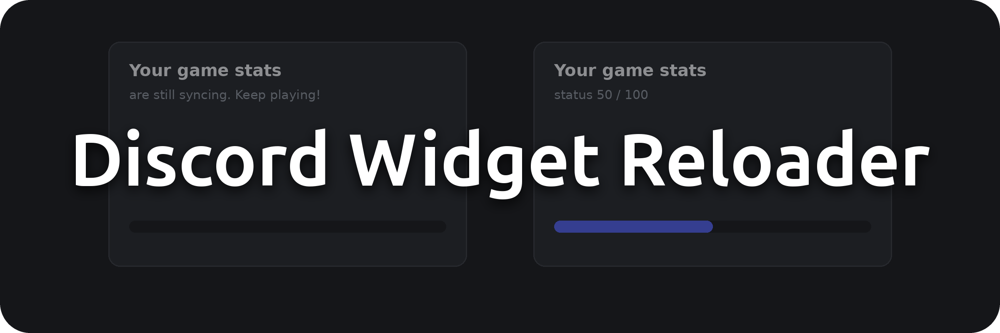

<div align="center">

<p align="center">
  
</p>

<p align="center"><b>English</b> | <a href="README.ja.md">日本語</a></p>

<h1 align="center">Discord Widget Reloader</h1>

<h3 align="center">Keep Discord Profile Widgets v2 from getting stuck on "still syncing".</h3>

<p align="center">A small always-on container that PATCHes your widget data to Discord's internal API at a fixed interval, so the profile widget does not stay on <code>Your game stats are still syncing. Keep playing!</code>.</p>

<p align="center">
  <a href="https://github.com/Lapius7/discordwidget-reloader/commits/main"></a>
  <a href="LICENSE"></a>
  <a href="https://www.docker.com"></a>
  <a href="https://www.python.org"></a>
  <a href="https://github.com/Lapius7/discordwidget-reloader/stargazers"></a>
</p>

<p align="center">
  <a href="#quick-start">Quick start</a> ·
  <a href="#prerequisites">Prerequisites</a> ·
  <a href="#configuration">Configuration</a> ·
  <a href="#troubleshooting">Troubleshooting</a>
</p>

</div>

---

> [!WARNING]
> Profile Widgets v2 is an experimental Discord feature that is not officially published. It may change or be removed without notice.
> Calling the internal API with a Bot Token is a gray area under Discord's terms of service. **Use it at your own risk.** Do not use it with many accounts or with very short intervals that load Discord's infrastructure.
> The author is not responsible for any disadvantage, such as an account suspension, caused by its use.

## Overview

Widgets shown on a Discord profile through the experimental "Profile Widgets v2" can stay on `Your game stats are still syncing. Keep playing!`. This container sends the contents of `widget_data.json` to the Discord API every `SYNC_INTERVAL_SECONDS` (default 300) seconds to avoid that state.

Reference: [Discord Widgets, chloecinders.com](https://chloecinders.com/blog/discord-widgets)

The script `app/sync.py` sends a `PATCH` to `https://discord.com/api/v9/applications/{APPLICATION_ID}/users/{USER_ID}/identities/0/profile` with an `Authorization: Bot <token>` header, and logs success or failure each time.

## Prerequisites

These are outside this container. Finish them on Discord first.

1. Create an application in the [Discord Developer Portal](https://discord.com/developers/applications) and enable `Games` → `Social SDK`.
2. Make the application team-owned. A personally owned application may not meet the conditions of the `Games` tab.
3. Enable the experiment flag in the browser developer console so the `Widget` tab appears, then create and publish a widget.
   - Flag names may change. See the blog post above and related communities for the latest.
4. Allow the `openid` + `sdk.social_layer` scopes with OAuth2 and finish authorization with a user token.
5. In the Discord client console, add the application ID to the featured applications list.
6. In User Settings → Edit Profile → Profile Widgets, add the widget to your profile.

> [!IMPORTANT]
> Until these are done, the profile does not change even if this container sends PATCH requests.

## Quick start

```bash
# 1. Get the repository
git clone https://github.com/Lapius7/discordwidget-reloader
cd discordwidget-reloader

# 2. Create the environment file
cp .env.example .env
nano .env
# Set DISCORD_APPLICATION_ID, DISCORD_USER_ID, DISCORD_BOT_TOKEN

# 3. Create the widget data to send
cp widget_data.sample.json widget_data.json
nano widget_data.json
# Rewrite it for your own widget, using the JSON from
# Developer Portal → Games → Widget → Sample Data tab → "Generate JSON"

# 4. Start
docker compose up -d --build

# 5. Check the logs (success or failure of each PATCH is printed)
docker compose logs -f

# 6. Stop
docker compose down
```

Layout:

```
discordwidget-reloader/
├── docker-compose.yml
├── Dockerfile
├── .env.example              ← copy to .env
├── widget_data.sample.json   ← copy to widget_data.json
└── app/
    └── sync.py               ← periodic PATCH script
```

## Configuration

| Environment variable | Description |
|---|---|
| `DISCORD_APPLICATION_ID` | Application ID shown in General Information of the Developer Portal |
| `DISCORD_USER_ID` | Your Discord user ID, the one that shows the widget |
| `DISCORD_BOT_TOKEN` | Token obtained with Reset Token on the Bot page |
| `SYNC_INTERVAL_SECONDS` | PATCH interval in seconds. Default 300 |

## Running on a VPS or other always-on host

Syncing continues only while this container runs. After you stop it, the last sent content stays displayed, but after a while (roughly several minutes to tens of minutes) the widget returns to the "syncing" display.

If you run it on a PC that gets powered off, syncing stops while it is off. Run the container on an always-on VPS or NAS instead.

## Troubleshooting

- **`403 {"message": "internal network error", "code": 40333}`**
  A request with `Authorization: Bot <token>` and a `User-Agent` header that imitates a browser can be rejected by Cloudflare as suspicious. `sync.py` does not set `User-Agent` explicitly, so Python's default is sent. Be careful if you add your own headers.
- **The PATCH succeeds but the profile does not change**
  The Discord client may hold a cache. Try `Ctrl+Shift+R` (browser) or reload the Discord app with `Ctrl+R`. The same applies right after you edit or publish the widget configuration.

> [!NOTE]
> Not verified in this README rework: running the container against the real Discord API, and the behavior of the experimental feature itself.

## License

[MIT](LICENSE)
